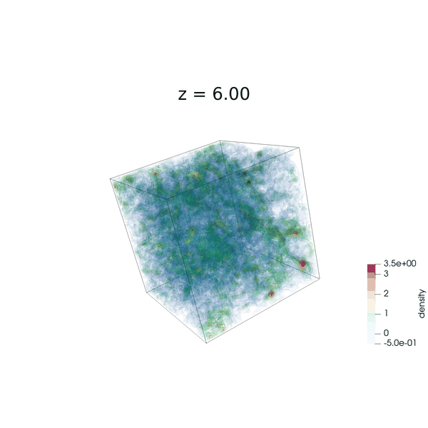
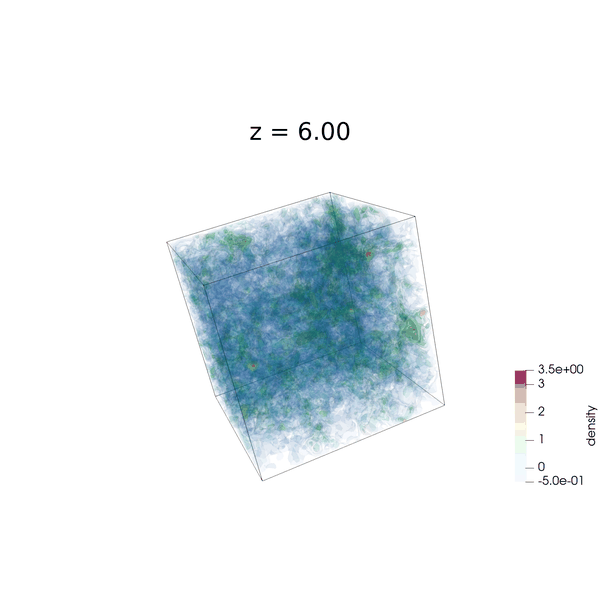
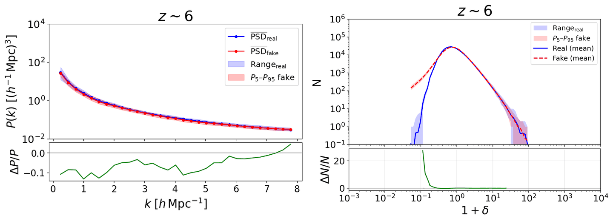
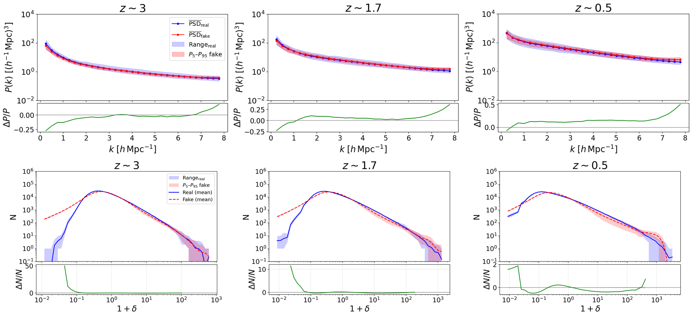
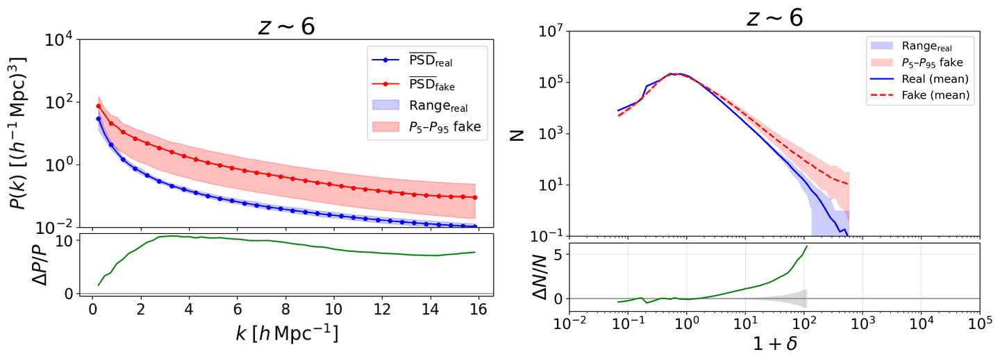
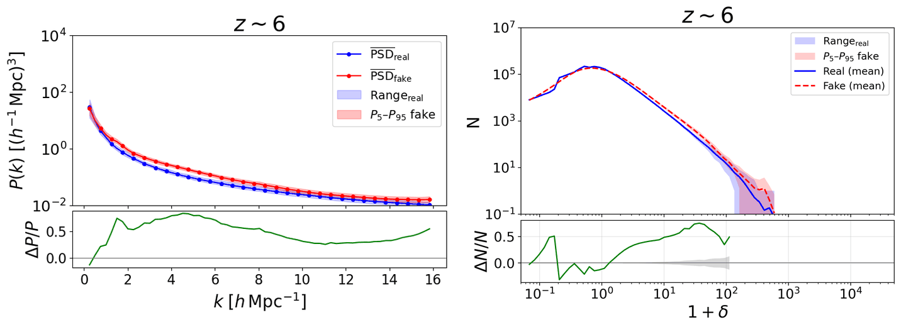

# Conditional WGAN-GP for 3D Cosmological Density Fields

Conditional Wasserstein GAN with gradient penalty (cWGAN-GP) that emulates 3D N-body simulation outputs, conditioned on redshift (z = 6 → 0). It generates the 34 snapshots of one simulation in about 1 s and follows a consistent evolution when the same latent noise is used at every redshift. The generator loss can optionally include a power spectrum (PSD) term to study the effect of be included on the training process.

Trained on the IllustrisTNG-DM cosmic-variance set of [CAMELS](https://camels.readthedocs.io): 27 simulations × 34 snapshots, (25 Mpc/h)³, deposited on 64³ and 128³ grids.

📄 [Paper](ENLACE_AL_PAPER): *The impact of power spectrum constraints on conditional WGANs for 3D cosmological density field emulation*

## Results

Errors refer to the relative error of the mean power spectrum (E_μ) and of its dispersion (E_σ).

### 64³ baseline (no PSD term)
E_μ = 1.2 · E_σ = 3.7 (epoch 683)

### 64³ with PSD term
E_μ = 0.13 · E_σ = 0.20 (epoch 663)

### 64³ with PSD term, interpolating unseen redshifts
Trained without z = 3, 1.72 and 0.46. Errors at those redshifts: E_μ = 0.10 · E_σ = 0.25 (epoch 620)

### 128³ baseline (no PSD term)
E_μ = 1.27 · E_σ = 4.70 (epoch 439)

### 128³ with PSD term
E_μ = 0.32 · E_σ = 0.26 (epoch 422)

|

The files to run for training are located in the `Models3D` folder:
* `Model_baseline_64.py` and `Model_baseline_128`: to train the baseline models for both grids.
* `Model_psd_dyn_64.py` and `Model_psd_dyn_64.py`: to train the models that add the PSD term to the loss, weighted by the ratio of the gradient norms, for both grids.
* `Model_interp_dyn.py`: the model that excludes certain redshifts during training, in order to check whether the model is able to reproduce them.

Once trained, the results can be generated with the scripts in the `Generate-results` folder. The epoch and the folder name must be changed depending on what you want to generate.
