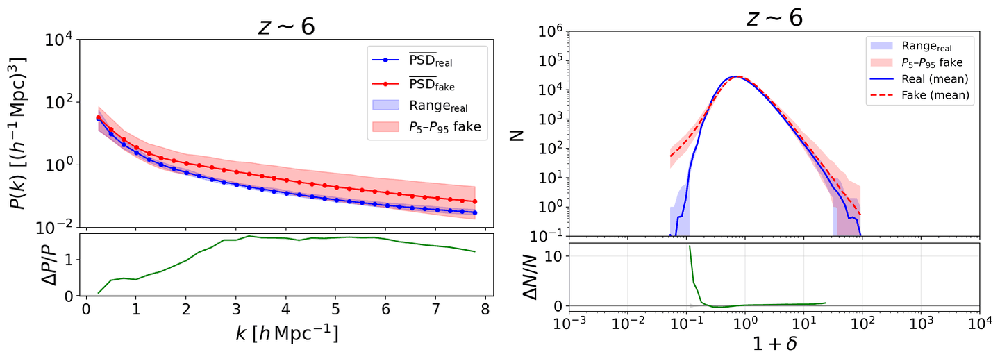
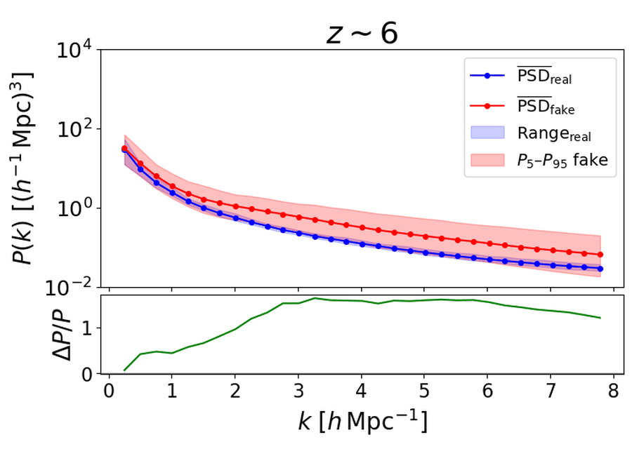
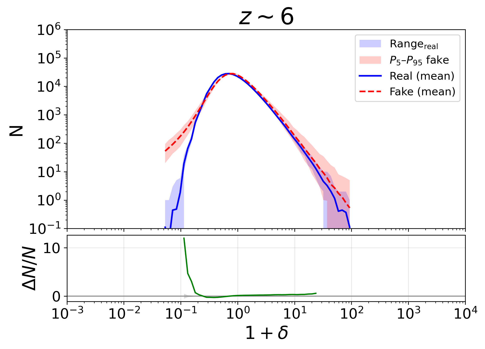
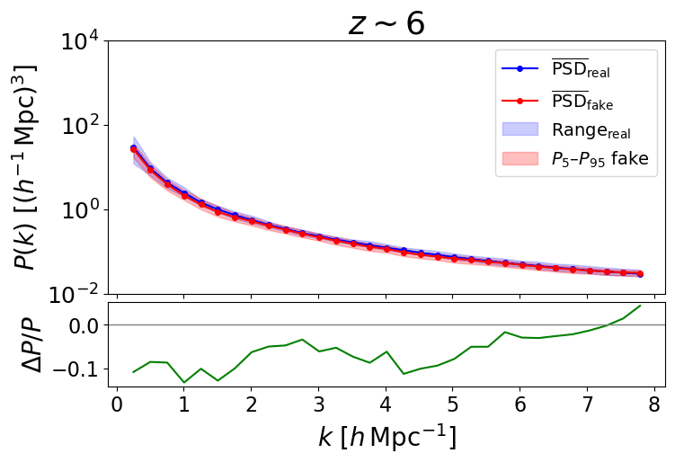
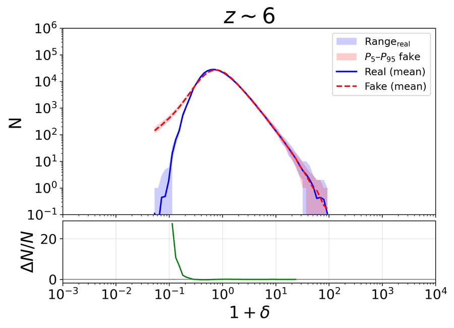
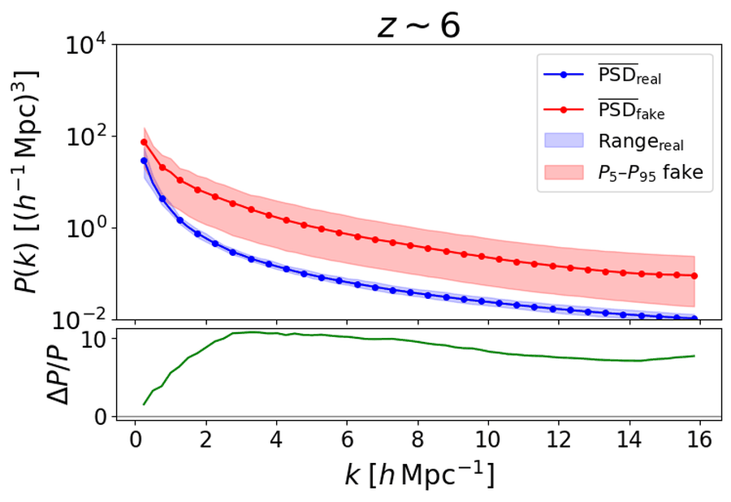
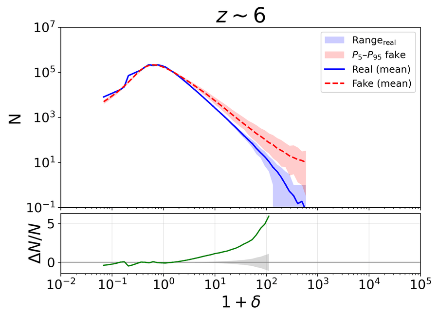
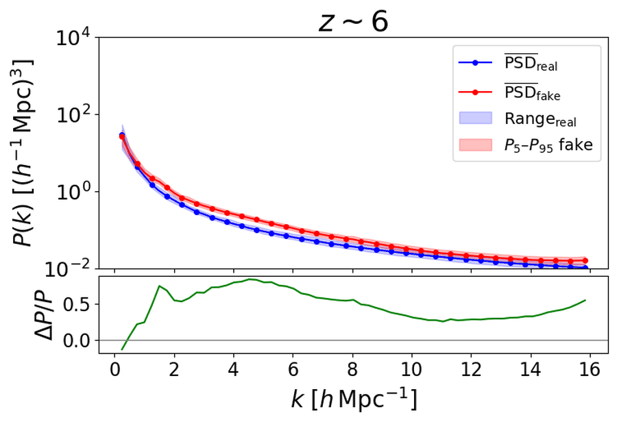
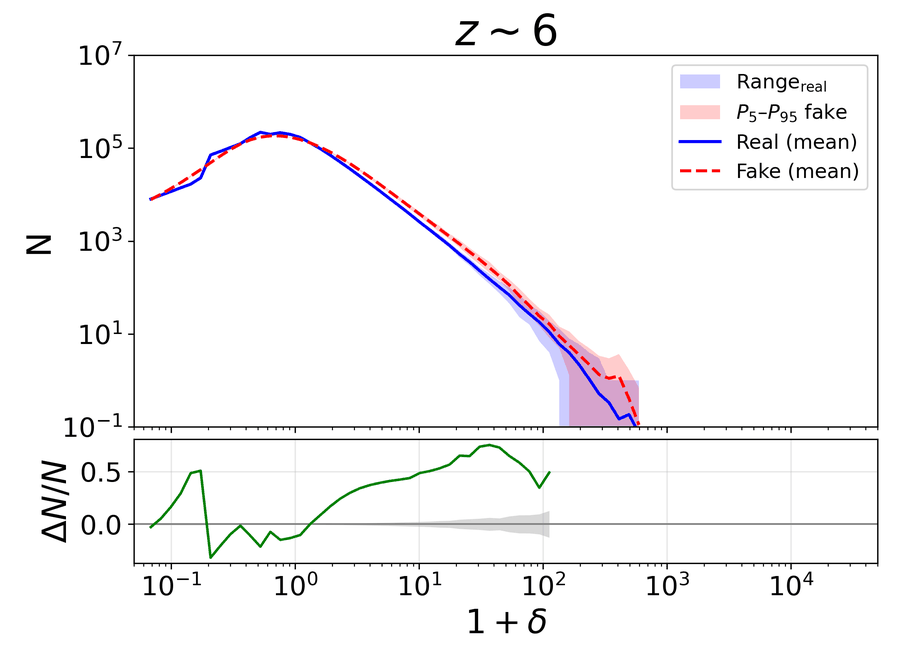

# Conditional WGAN-GP for 3D Cosmological Density Fields

Conditional Wasserstein GAN with gradient penalty (cWGAN-GP) that emulates 3D N-body simulation outputs, conditioned on redshift (z = 6 → 0). It generates the 34 snapshots of one simulation in about 1 s and follows a consistent evolution when the same latent noise is used at every redshift. The generator loss can optionally include a power spectrum (PSD) term.

Trained on the IllustrisTNG-DM cosmic-variance set of [CAMELS](https://camels.readthedocs.io): 27 simulations × 34 snapshots, (25 Mpc/h)³, deposited on 64³ and 128³ grids.

📄 [Paper](ENLACE_AL_PAPER): *The impact of power spectrum constraints on conditional WGANs for 3D cosmological density field emulation*

## Results

Errors refer to the relative error of the mean power spectrum (E_μ) and of its dispersion (E_σ).

### 64³ baseline (no PSD term)
E_μ = 1.2 · E_σ = 3.7 (epoch 683)

| PSD | Histogram |
|:---:|:---:|
|  |  |

### 64³ with PSD term
E_μ = 0.13 · E_σ = 0.20 (epoch 663)

| PSD | Histogram |
|:---:|:---:|
|  |  |

### 64³ with PSD term, interpolating unseen redshifts
Trained without z = 3, 1.72 and 0.46. Errors at those redshifts: E_μ = 0.10 · E_σ = 0.25 (epoch 620)

| PSD | Histogram |
|:---:|:---:|
|  |  |

### 128³ baseline (no PSD term)
E_μ = 1.27 · E_σ = 4.70 (epoch 439)

| PSD | Histogram |
|:---:|:---:|
|  |  |

### 128³ with PSD term
E_μ = 0.32 · E_σ = 0.26 (epoch 422)

| PSD | Histogram |
|:---:|:---:|
|  |  |

Los archivos que hay que ejecutar para realizar el entrenamiento se encuentran en la carpeta Models3D:
- Model_baseline_64.py y Modelo_baseline_128: Para entrenar los modelos base del ambos grids
- Model_psd_dyn_64.py y Model_psd_dyn_64.py: Para entrenar los modelos que incoporan PSD a la loss con el cociente de las normas de los gradiente para ambos grids.
- Model_interp_dyn.py: Es el modelo que excluye ciertos redshifts durante el entrenamiento y así comprobar si el modelo es capaz de reproducirlo.

Una vez se haya entrenado, se pueden generar los resultados mediante los escripts en la carpeta Generate-results: Hay que cambiar la época y el nombre del a carpeta según lo que se quira generar
